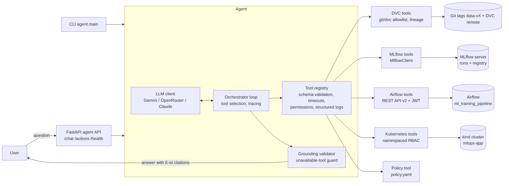
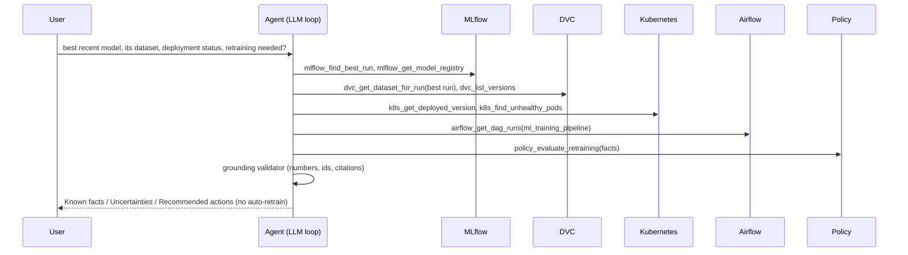
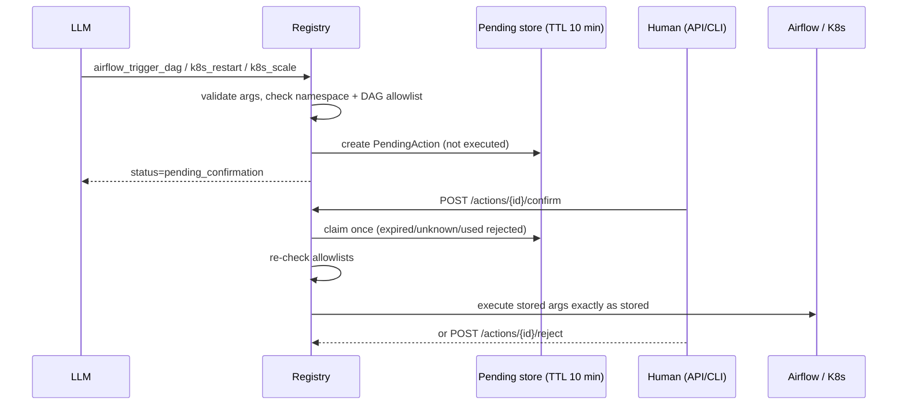
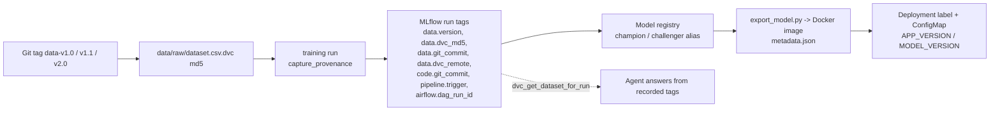

# Architecture

## Components (Figure 1)

The agent never answers operational questions from model knowledge. Every fact must come from a tool result of the current request and is cited as `[E-xxxxxx]`.

## Mandatory scenario (sequence)

## Confirmation flow for mutating actions

The LLM has no tool that confirms. Delete, exec and apply tools do not exist.

## Provenance (data and model lineage)

`dvc_get_dataset_for_run` reads the tags recorded at training time, not the current workspace.

## Trust boundaries

| Boundary | Control |
|---|---|
| LLM to tools | Pydantic `extra=forbid` schemas, per-tool timeouts, errors returned as `ToolResult` (never raised), tool list is closed |
| Mutations | Two-phase confirmation; only the human API/CLI can confirm; allowlists re-checked at execution |
| Kubernetes | Namespace allowlist (`mlops-app`) checked before any API call, plus a namespaced Role: no delete/exec, no other namespaces, `patch` only on deployments/scale |
| Airflow | JWT from `/auth/token`; only `APPROVED_DAGS` can be triggered |
| DVC / Git | Command allowlist, `shell=False`, revision regex + `git rev-parse --verify`, `dvc get` only into a scratch directory |
| Secrets | `.env` only; logs redact keys, tokens, bearer values, `sk-ant-` strings and JWTs; kubeconfig lives outside the repo |
| Answers | Grounding validator: numbers, ids, versions, pod names and citations must appear in an `ok` tool result; otherwise re-ask once, then strip |

## Pipeline (Figure 2)

`validate_dataset >> preprocess_data >> train_model >> evaluate_and_log_mlflow >> apply_quality_gate` with retries (2, exponential backoff). Deterministic failures (validation, gate) raise `AirflowFailException` so they do not retry; downstream tasks become `upstream_failed` and no model is registered or aliased.
